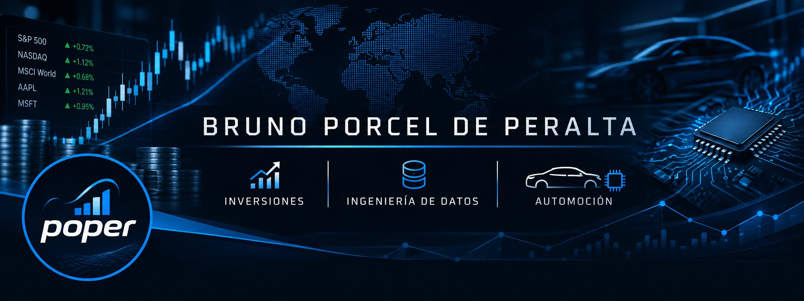

### Hi, I'm Bruno

Automotive technical teacher learning data engineering by building a real system, one step at a time.

I teach automotive specialty subjects at a technical school in Córdoba, Argentina. Before teaching, I worked in continuous improvement (World Class Manufacturing / World Class Administration) for logistics operations at automotive and consumer-goods plants. That background shapes how I build software: small steps, measure, improve.

#### Current project: [PWOS — Personal Wealth Operating System](https://github.com/bporcel-code/pwos)

A system that brings investments, accounts, real estate and debts into one place, built for the Argentine market.

- Imports exports from brokers, banks and digital wallets, with a dry run first and deduplication
- Values everything in a single unit of account (MEP dollar)
- Answers questions like net worth, gain vs. contributions, income calendar, concentration, and bond analytics (IRR, duration, carry)
- In daily use with real data. The public repo includes a demo with a fictitious investor that runs end to end with Docker

#### What I work with

Python · SQL / SQLite · pandas · FastAPI · Docker · n8n · pytest · GitHub Actions

#### How I work

- Every architecture decision is written down as an ADR
- Tests and CI before anything is published
- Built with AI assistance (Claude) as mentor and pair programmer; I aim to understand every decision, not just ship code

#### Contact

[LinkedIn](https://www.linkedin.com/in/bruno-porcel-de-peralta-98460956/)

<b>En español</b>

Profesor de la especialidad automotor, aprendiendo ingeniería de datos mientras construyo un sistema real, paso a paso.

Doy materias de la especialidad automotor en una escuela técnica de Córdoba, Argentina. Antes de la docencia trabajé en mejora continua (World Class Manufacturing / World Class Administration) para operaciones logísticas en plantas automotrices y de consumo masivo. Esa base define cómo construyo software: pasos chicos, medir, mejorar.

**Proyecto actual: [PWOS](https://github.com/bporcel-code/pwos)**, un sistema operativo patrimonial que reúne inversiones, cuentas, inmuebles y deudas en un solo lugar, pensado para el mercado argentino. Está en uso diario con datos reales. El repo público trae una demo con un inversor ficticio.

